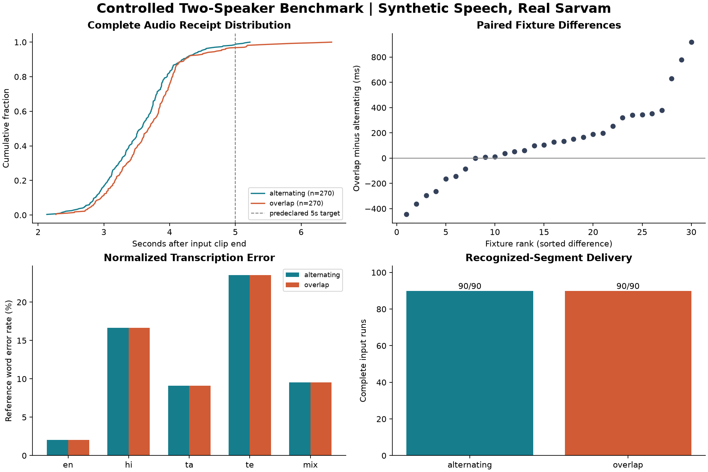

# Sarvam Interpreter: Consolidated Testing Report

Compiled 2026-10-13. Controlled measurement: 2026-10-12. Human review supplied by the project owner.

## Executive Summary

Sarvam Interpreter is a browser-based speech-to-speech translation application for English, Hindi, Tamil and Telugu, including Tamil-English code-mixed inputs. This report combines the completed real-provider controlled benchmark, user-supplied bilingual human reviews, cached browser playback validation and earlier developmental tests. It assesses an application integrating Sarvam models, not a newly trained speech or translation model.

| Evidence | Observed result | Meaning |
| --- | --- | --- |
| Controlled delivery | 180/180 inputs; 540/540 stable-listener outputs | All recognized segments delivered in this sample |
| Audio receipt p95 | 4.49s alternating; 4.79s overlap | After nominal input clip end; playback excluded |
| Human meaning ratings | 4.62/5; 77/90 scored >=4 | 90 reviewed outputs from 30 unique fixtures |
| Cross-language subset | 4.62/5; 62/72 scored >=4 | 72 outputs; same-language outputs excluded |
| Browser replay | 24/24 clips started and ended | Actual player; cached audio and mocked socket |
| Grouped fan-out | 540 pipelines for 720 recipient deliveries | 25% fewer logical translation/TTS invocations |

Conclusion: the tested architecture delivered complete two-speaker results, with strong but non-uniform meaning ratings. Code-mixed and Telugu inputs expose the most important semantic issues. Browser FIFO queueing is a remaining user-perceived latency bottleneck. These findings support a well-evidenced portfolio project, not a production reliability or universal translation-accuracy claim. [S01-S06]

## Test Scope and Methodology

| Test layer | Design | Sample / boundary |
| --- | --- | --- |
| Controlled benchmark | Real Sarvam APIs; independent speaker streams; one Docker worker; localhost WebSockets | 30 cached synthetic fixtures; 90 trials; 180 input runs |
| Conditions | 15 fixed fixture pairs; 3 repetitions; randomized/counterbalanced order; seed 20261012 | Alternating: 1s inter-clip gap. Overlap: second speaker starts 0.3s later |
| Participants | 2 speaker participants plus 3 stable listen-only targets | Target languages rotate across the 4 supported languages |
| Human review | Owner confirms bilingual human reviewers assessed text and listened to saved audio | 90 outputs: alternating condition, repetition 1 only |
| Playback replay | Cached WAV arrivals replayed through actual frontend FIFO media player | 12 cases; 24 clips; desktop and mobile-sized viewports |
| Historical tests | Single-speaker structured campaign, two smoke runs, short timeout regression soak | Different protocols; not pooled with controlled results |

The benchmark ran on 12 October 2026 local time; this report and review-method confirmation are dated 13 October 2026. Sources contain 6 fixtures per category: English, Hindi, Tamil, Telugu and Tamil-English mix. PCM is mono 16kHz / 16-bit, paced in 100ms frames. Each trial waits for upstream end and translation-worker drain, then checks complete final transcript sequence sets and valid WAV payloads. Two diagnostic trials are excluded from measured results. [S01, S02]

Configured models: saaras:v3-realtime (auto language, codemix, fast stream), mayura:v1 translation and bulbul:v3 synthesis (kavitha, 16kHz WAV). VAD settings: 500ms silence, threshold 0.3, 250ms minimum speech. These settings identify this experiment; they are not claimed to be optimal.

## Delivery, Completeness and Concurrency

| Check | Alternating | Overlap | Overall |
| --- | --- | --- | --- |
| Measured trials | 45/45 | 45/45 | 90/90 |
| Complete input runs | 90/90 | 90/90 | 180/180 |
| Stable-listener checks | 270/270 | 270/270 | 540/540 |
| Failed measured trials | 0 | 0 | 0 |
| Retries / replacements | 0 | 0 | 0 at measured-trial level |
| Invalid / duplicate WAVs | 0 | 0 | 0 |

Provider end counts match collected transcript counts for 180/180 speaker sessions; 180/180 fixture transmissions are complete. Independent evidence validation passed checks of manifest/build hashes, fixture/event/WAV hashes, secret-field exclusion, provider-end counts, output sequence completeness and recomputed percentiles. [S03]

Delivery means every final recognized segment had a matching translated text and valid audio payload for every stable listener. It does not mean the transcript or translation was semantically correct. The human-reviewed incomplete translations illustrate why successful transport and successful meaning preservation must remain separate.

The two-speaker model keeps streams and workers independent; it does not separate voices mixed into one microphone. The campaign observes one utterance per speaker session and is not sustained-conversation backpressure, multi-room capacity or more-than-two-speaker stress testing. No measured trial replacements occurred; internal SDK/HTTP retries were not separately logged.

Both predeclared exploratory targets were met: at least 95% complete delivery and overall post-clip receipt p95 no greater than 5s in each condition. The descriptive 90-input Wilson interval is 95.91%-100%, but repetitions share fixtures and are dependent, so this is not a production SLA confidence guarantee.

## Latency and Overlap Cost

| Timing boundary | Alternating p50 / p95 | Overlap p50 / p95 |
| --- | --- | --- |
| Input start to first audio receipt | 7.304s / 8.951s | 7.325s / 9.148s |
| Clip end to last audio receipt | 3.564s / 4.488s | 3.677s / 4.790s |
| Threshold signal end to last receipt | 3.823s / 4.748s | 3.969s / 4.923s |

Each condition has 270 target observations. Percentiles use nearest rank: sorted index ceil(p*n)-1. Nominal clip end can include trailing silence; threshold signal end is the final sample above amplitude 400, not human-labelled speech end. Input-start timing includes speaking duration. Capture, public-tunnel/WAN transit and actual playback start are excluded. [S01, S02]

| Server stage | Alternating p50 / p95 | Overlap p50 / p95 |
| --- | --- | --- |
| STT | 3735 / 4947 ms | 3797 / 5055 ms |
| Worker queue | 0 / 0 ms | 0 / 0 ms |
| Translation | 1813 / 2120 ms | 1825 / 2209 ms |
| TTS | 1156 / 1742 ms | 1180 / 1949 ms |

STT stage timing runs from VAD speech-start to committed transcript and includes speaking duration, not isolated inference time. Do not sum stage percentiles or add playback-replay percentiles to receipt percentiles.

Matched repetitions/targets were averaged within fixture. Mean paired overlap-minus-alternating post-clip delay was +129.90ms. The 2,000-resample fixture bootstrap 95% interval is +26.81 to +240.53ms; grouping the two fixtures sharing each trial into 15 pair blocks gives +2.28 to +276.59ms. This is a small positive overhead in this dataset, not zero overlap penalty or a general-network estimate.

## Language-Specific Timing and Recognition

| Source | Alt. p50 / p95 | Overlap p50 / p95 | WER / CER |
| --- | --- | --- | --- |
| English | 3.162s / 3.752s | 3.391s / 4.679s | 2.04% / 2.56% |
| Hindi | 3.789s / 4.555s | 3.882s / 5.846s | 16.67% / 19.67% |
| Tamil | 3.533s / 4.615s | 3.602s / 4.790s | 9.09% / 0.71% |
| Telugu | 3.731s / 4.551s | 3.861s / 4.320s | 23.53% / 17.33% |
| Tamil-English mix | 3.509s / 4.689s | 3.579s / 4.079s | 9.52% / 3.33% |

Each source category contributes 18 input runs and 54 target observations per condition. Overall normalized WER is 11.65% (72 word edits / 618 reference words per condition); CER is 8.01% (270 character edits / 3,369 reference characters). WER/CER are identical between alternating and overlap in this sample. They are script-comparison metrics, not translation accuracy. [S02]

The aggregate p95 meets 5s, but Hindi-source overlap p95 is 5.846s. Aggregation therefore hides a slower source subgroup. Source/target cells in the raw language-pair table provide additional descriptive detail; the sample is too small to rank languages universally.

References are TTS input scripts, not independently human-transcribed source waveforms. Code-mix transliteration, word segmentation and TTS pronunciation can increase edit distance without equivalent semantic loss. Hindi presentation script changes and Tamil compound-word splitting are examples. Telugu te_3 also has reviewer-reported STT corruption propagated into translation. Do not convert 1-WER into translation accuracy or claim all reference mismatches are STT-only failures.

## Controlled Measurement Distributions

Original controlled benchmark plots. Receipt ECDFs use 270 target observations per condition. The paired plot averages repetitions/targets within each of 30 fixtures. WER is script comparison, not translation quality. Complete-input bars show 90/90 input runs per condition.

Reading the figure: the receipt ECDF rises more slowly for overlap, consistent with the +129.90ms paired mean overhead. The fixture-difference plot shows variation rather than a uniform overlap cost. Reference WER is unchanged between conditions. Complete-input counts remain equal despite concurrent speaker input.

The figure visualizes already-tabulated automated evidence, not additional observations. It excludes playback timing and human-review scores. Related targets/repetitions must not be treated as independent speech samples. [S02]

## Bilingual Human Review: Overall Results

The submitted sheet has 270 rows, all alternating-condition outputs across three repetitions. Exactly 90 have reviewer labels, reviewed status and valid 1-5 scores; 180 are unreviewed and excluded. The 270 overlap outputs from the controlled benchmark are not present in the submission and have no human ratings. All 30 unique controlled fixtures have three reviewed target outputs from repetition 1. [S04]

| Score | Interpretation used for reporting | Count | Share |
| --- | --- | --- | --- |
| 5 | All important meaning preserved | 73 | 81.11% |
| 4 | Minor wording issue; meaning mostly preserved | 4 | 4.44% |
| 3 | Noticeable error/omission; general idea understandable | 9 | 10.00% |
| 2 | Major meaning error / incomplete translation | 4 | 4.44% |
| 1 | Unusable or contradictory | 0 | 0.00% |

| Quality statistic | Observed value |
| --- | --- |
| Arithmetic mean / median | 4.6222 / 5.0 out of 5 |
| Score >=4 threshold share | 77/90 = 85.56% |
| Below-threshold outputs | 13/90 = 14.44% |
| All three targets scored >=4 | 25/30 fixtures |
| Fixtures with any non-perfect rating | 9/30 fixtures |

The owner confirms bilingual humans reviewed text and listened to the saved audio. The sheet uses four language-labelled reviewer IDs, with 22 English, 22 Hindi, 24 Tamil and 22 Telugu rows; these labels do not establish four independently verified people or their qualifications. No review timestamps, blind-rating protocol, second ratings, inter-rater agreement or separate audio-intelligibility scores were supplied.

A score of at least 4 is a descriptive reporting threshold, not an independently audited safety rule. Ratings are ordinal; the mean is a descriptive summary. Do not convert 4.62/5 into 92.4% accuracy. Related targets share a fixture, so 90 ratings are not 90 independent speech samples. No inferential human-quality interval is asserted.

## Human Review: Language Coverage

| Source category | Ratings | Mean /5 | Score >=4 | Below 4 |
| --- | --- | --- | --- | --- |
| English | 18 | 4.94 | 18/18 (100.0%) | 0 |
| Hindi | 18 | 5.00 | 18/18 (100.0%) | 0 |
| Tamil-English mix | 18 | 4.28 | 13/18 (72.2%) | 5 |
| Tamil | 18 | 4.67 | 15/18 (83.3%) | 3 |
| Telugu | 18 | 4.22 | 13/18 (72.2%) | 5 |

| Target language | Ratings | Mean /5 | Score >=4 | Below 4 |
| --- | --- | --- | --- | --- |
| English | 22 | 4.73 | 20/22 (90.9%) | 2 |
| Hindi | 22 | 4.59 | 18/22 (81.8%) | 4 |
| Tamil | 24 | 4.54 | 20/24 (83.3%) | 4 |
| Telugu | 22 | 4.64 | 19/22 (86.4%) | 3 |

| Output subset | Ratings | Mean /5 | Score >=4 |
| --- | --- | --- | --- |
| Cross-language + mixed-source | 72 | 4.625 | 62/72 (86.11%) |
| Same-language monolingual | 18 | 4.611 | 15/18 (83.33%) |

The headline 90-output result includes 18 monolingual same-language outputs. The 72-output cross-language subset includes every Tamil-English mixed-source result, since a mixed source has no single same-language target. Mixed-source to Tamil/English is partly language normalization rather than a clean monolingual cross-language task. These subset rules are explicit to prevent inflated translation claims.

Source totals are balanced at 18 ratings each; targets are not exactly balanced (22/22/24/22). Source-target cells contain only 3-6 ratings. Apparent differences may reflect the six selected sentences, target difficulty and reviewer calibration; they do not establish a model-wide language ranking. [S04]

## Human Review: Source-to-Target Detail

| Source | Target | n | Mean /5 | Score >=4 |
| --- | --- | --- | --- | --- |
| English | English | 3 | 5.00 | 3/3 (100.0%) |
| English | Hindi | 5 | 5.00 | 5/5 (100.0%) |
| English | Tamil | 5 | 5.00 | 5/5 (100.0%) |
| English | Telugu | 5 | 4.80 | 5/5 (100.0%) |
| Hindi | English | 5 | 5.00 | 5/5 (100.0%) |
| Hindi | Hindi | 5 | 5.00 | 5/5 (100.0%) |
| Hindi | Tamil | 4 | 5.00 | 4/4 (100.0%) |
| Hindi | Telugu | 4 | 5.00 | 4/4 (100.0%) |
| Tamil-English mix | English | 4 | 4.25 | 3/4 (75.0%) |
| Tamil-English mix | Hindi | 4 | 4.50 | 3/4 (75.0%) |
| Tamil-English mix | Tamil | 5 | 3.80 | 3/5 (60.0%) |
| Tamil-English mix | Telugu | 5 | 4.60 | 4/5 (80.0%) |
| Tamil | English | 6 | 4.67 | 5/6 (83.3%) |
| Tamil | Hindi | 4 | 4.50 | 3/4 (75.0%) |
| Tamil | Tamil | 5 | 4.60 | 4/5 (80.0%) |
| Tamil | Telugu | 3 | 5.00 | 3/3 (100.0%) |
| Telugu | English | 4 | 4.75 | 4/4 (100.0%) |
| Telugu | Hindi | 4 | 3.75 | 2/4 (50.0%) |
| Telugu | Tamil | 5 | 4.40 | 4/5 (80.0%) |
| Telugu | Telugu | 5 | 4.00 | 3/5 (60.0%) |

These 20 cells describe the available 90 first-repetition ratings, not all possible utterances or all overlap translations. English-source and Hindi-source ratings are high in this small sample; Tamil-English mixed-source and Telugu-source examples account for most reported below-threshold outputs. Full original text, translated text, corrections and notes are retained in the immutable review snapshot and reviewed-observations appendix. [S04]

## Qualitative Error Catalogue

Seventeen outputs received a non-perfect score across nine fixtures: 4 major/incomplete outputs scored 2, 9 noticeable-error outputs scored 3 and 4 minor-issue outputs scored 4. The catalogue below groups repeated target-level notes by fixture, without treating three affected targets as three independent underlying incidents.

| Fixture / issue | Affected targets; scores | Reviewer finding |
| --- | --- | --- |
| mix_2: Semantic role shift | hi, ta, te; 3, 3, 3 | Busy attributed to the person rather than the route. Review the source phrasing and preserve who/what the modifier describes. |
| mix_7: Incomplete content | ta, en; 2, 2 | Tamil and English target translations were rated incomplete / cut off. Valid WAV delivery does not prove full semantic content. |
| te_10: Travel-direction mistranslation | hi, te; 2, 2 | Hindi and Telugu outputs were described as dropping off / picking up to take home instead of the intended meaning. |
| te_3: STT error propagation | hi, ta, te; 3, 3, 3 | The Telugu deadline expression was misrecognized; reviewer notes say the corrupted phrase propagated to all three targets. |
| ta_2: STT error propagation | en, hi, ta; 3, 3, 3 | Reviewer notes say the Tamil time/context expression was misrecognized, changing the intended context to 'here'. |
| te_4: Relationship detail changed | ta; 4 | Younger brother became older brother in Tamil. Rated 4, but the relationship fact changed. |
| mix_4: Output repetition | ta; 4 | Tamil output repeated the quantity marker ('a 1' in the review description). |
| en_13: Meaning nuance | te; 4 | Telugu wording changed 'moved' to 'postponed'. |
| te_13: Awkward phrasing | en; 4 | English output was described as 'changed at 3 o'clock'. |

Six below-threshold outputs across te_3 and ta_2 were explicitly attributed to upstream STT errors in reviewer notes; the other seven below-threshold outputs span semantic role shift, incomplete translation and travel-direction mistranslation. This is note-based attribution, not experimentally isolated root-cause proof. All these outputs passed transport/WAV completeness checks.

The Tamil younger/older-brother example scored 4, illustrating that the >=4 threshold cannot stand in for a critical-factual-error rate. No dedicated critical-error field or formal severity audit exists; therefore no critical-error percentage is reported. The six supplied correction fields for te_3/ta_2 are preserved as submitted, not treated as an independently verified replacement transcript. [S04]

## Playback and Interface Validation

| Viewport | Condition | Clips | Receive-to-play p50 | p95 |
| --- | --- | --- | --- | --- |
| Desktop | alternating | 6 | 76.40ms | 162.20ms |
| Desktop | overlap | 6 | 82.40ms | 4293.80ms |
| Mobile-sized | alternating | 6 | 71.40ms | 109.50ms |
| Mobile-sized | overlap | 6 | 347.90ms | 4522.20ms |

Replay covered 12 cases at 1440x1000 and 390x844. All 24 clips started and ended exactly once; no media errors, case errors or horizontal overflow were recorded, and FIFO order was checked. Edge/Chromium version: 154.0.4258.62. The small mobile viewport is not physical mobile-hardware validation. [S05]

Overlap receive-to-playing p95 was 4.294s on desktop and 4.522s in the mobile-sized viewport. Queueing preserves complete clips but can delay the second speaker's translation while the first is playing. This is the most visible latency trade-off in the evidence; p95 receipt below 5s does not imply sub-5s human-heard translation.

Frontend regression coverage includes visible microphone icons; manual mute/unmute; actual local audio-track disable while the playback guard is enabled; automatic recovery without overriding manual mute; continued PCM capture when the guard is disabled; queued two-speaker playback; and desktop/mobile layout checks. This is automated component coverage, not evidence that every browser/physical microphone behaves identically. [S07]

The owner previously reported the basic live features working. No structured real-laptop acceptance log, human microphone-latency trace or participant satisfaction survey was submitted, so those are recorded as informal feedback rather than quantified usability results.

## Historical Tests and Timeout Regression

| Campaign | Result | Interpretation |
| --- | --- | --- |
| Structured developmental campaign (9 Oct) | 92/92 fixtures; 368/368 final target receipts; 2 controlled retries | Input-start first receipt p50 7.233s, p95 9.700s |
| Five-fixture pilot | Preparation data reused by the structured campaign | Not additional independent evidence |
| Two earlier room smoke runs | 8 sessions per file; 32 audio events per file | 16 sequential session records; not simultaneous-room scale |
| Timeout-fix real-provider soak | 215.203s; both speakers translated again after 210s | Exceeded reported 2-3 minute failure window; not 30-minute endurance |
| Backend/harness regression suite | 32 tests passed on Windows again on 13 Oct; prior Linux Docker check also passed | Mocked/offline regression evidence, not paid live delivery |

The structured campaign used one speaker and four listeners, with a different timing boundary (speaker send-start to first audio receipt). The first 14 successes lacked the later explicit 0.8s silence tail, implementation was hardened during the campaign, and two failed cases were retried. Its zero final missing outputs are not a zero-first-attempt-failure claim. Do not pool its timings with the later counterbalanced benchmark or compute a latency improvement percentage. [S08]

The timeout incident was traced to an application SESSION_SECONDS=60 timer, despite unlimited credit allowances. The fix separates the spending allowance from the session timer and reports explicit expiry. The owner chose a 30-minute limit. Saved soak evidence shows listener audio from both speakers initially at 5.453s/5.797s and again at 214.859s/215.094s; no error events were reported and the run ended cleanly. [S09]

The 13 October Windows recheck completed 32 tests in 15.249s with normal filesystem access. An initial sandbox-restricted attempt encountered temporary-file errors and stalled; it was stopped, and the unrestricted offline rerun passed. A Starlette/httpx deprecation warning remains non-fatal; no dependency upgrade was performed for this reporting task.

Earlier smoke files and developmental results are retained for completeness, but do not strengthen the independent-sample denominator of the controlled study. The originally credit-exhausted structured attempt is historical only; the later 92-fixture campaign completed it. The full 30-minute endurance test remains intentionally unperformed.

## Resource Usage and Fan-Out Efficiency

| Measured component | Quantity | Archived rate | Computed INR, ex GST |
| --- | --- | --- | --- |
| Provider audio duration | 1,129s over 180 sessions | 30 per hour | 9.408 |
| Successful translation input | 23,508 characters | 20 per 10,000 characters | 47.016 |
| Observed TTS input | 24,769 characters | 30 per 10,000 characters | 74.307 |
| Measured processing estimate | Diagnostics excluded | Rates archived on 12 Oct 2026 | 130.731 |

The controlled benchmark's conservative reservation ledger, including diagnostic activity, estimates INR 215.861 ex GST because STT reserves whole bounded sessions. The earlier structured campaign reservation estimate is INR 112.111 ex GST. These different scopes are not actual account billing receipts; they are not summed into a lifetime spend claim. Internal failed/retried HTTP requests, fixture generation and other development calls may add charges. No provider balance was queried. [S06, S08]

Observed grouping: 540 successful distinct-target translation/TTS pipelines delivered 720 recipient-level audio outputs (540 stable-listener outputs plus 180 speaker-recipient outputs). A per-recipient design would invoke each pipeline 720 times for these observed recipients, so the computed logical-call reduction is (720-540)/720 = 25.00%, for translation and TTS separately.

This is architectural reuse quantified from observed recipient lists, not an A/B billing, speed or total-cost experiment. It does not mean 25% lower total Sarvam charges. The current compilation, human-rating aggregation and document rendering reuse cached evidence and make no live API calls, so they consume no additional Sarvam credits.

## Data Integrity, Boundaries and Remaining Gaps

| Submission integrity check | Result |
| --- | --- |
| Unique keys / benchmark matches | 270/270 matched; no duplicate keys |
| Reviewed / unreviewed submitted | 90 / 180 |
| Unsubmitted benchmark outputs | 270 overlap outputs; no human score inferred |
| Identity, text and WAV hashes | Preserved; only human fields and formatting differences accepted |
| Receipt-time export rounding | 132 cells; max 0.005ms difference |
| WAV-duration export rounding | 193 cells; max 0.0000005s difference |

All quantitative performance calculations use original benchmark data, not the rounded review export. Original benchmark native_review.csv remains unchanged and historically unreviewed; the new submission is archived separately with its original bytes and SHA-256. Ratings are joined by trial, fixture, speaker, target language, receiver and sequence, not by row position.

Evidence limitations: synthetic voice and only six fixtures per source; shared development laptop; no independent source-waveform transcript audit; reviewer credentials/blinding/calibration unrecorded; one score per output; qualitative audio listening without a distinct intelligibility metric; no overlap human reviews; and no production-scale or noisy-human-speech study.

Untested boundaries: full 30-minute endurance, sustained-conversation queue saturation, WAN/tunnel end-to-end timing, physical mobile hardware, simultaneous multi-room throughput and more than two unmuted microphones. Browser AEC/noise suppression is requested, but acoustic source separation or Zoom/Meet-equivalent proprietary audio processing is not implemented or demonstrated.

The max_frame_lateness_ms value of zero in the controlled harness measures next-frame deadline overrun after send, not absolute dispatch jitter. It cannot support a zero-jitter claim. Reviews of generated audio also do not constitute field validation of actual human accents or microphone acoustics.

## Findings, Priorities and Portfolio Claims

| Priority | Evidence-led next work | Verification to use |
| --- | --- | --- |
| 1. Semantic correctness | Investigate mix_2, mix_7, te_10, te_3 and ta_2; separate source/STT/translation causes | Corrected-source probes, bilingual re-review; preserve this baseline |
| 2. Playback latency | Reduce long overlap queues without cutting off meaning | Measure actual receipt-to-playing and complete content on matched inputs |
| 3. Review robustness | Add critical factual-error flags and second ratings on disagreement-prone cases | Report agreement and original/adjudicated scores separately |
| 4. Real speech | Add diverse consented human recordings and short two-laptop acceptance notes | New held-out set, browser/network context and human-labelled speech end |

Overall judgement: a functional and benchmarked multilingual conferencing prototype with demonstrated independent two-speaker handling, complete recognized-output delivery and reproducible evidence. Human review adds strong meaning-preservation ratings while making semantic failure modes visible. No new paid infrastructure or architectural expansion is necessary solely to make it resume-worthy.

Defensible wording: 'Built a Dockerized, WebSocket-based speech translation app across four languages with two concurrent speaker streams; validated 180/180 controlled inputs and 540/540 listener audio outputs across alternating and overlapping speech.'

Defensible wording: 'Evaluated 90 multilingual outputs using bilingual human text/audio review, averaging 4.62/5 for meaning preservation; 85.6% scored at least 4 (30 synthetic source fixtures, alternating condition).' For a strictly cross-language claim use 4.62/5 and 62/72 outputs instead.

Defensible wording: 'Observed post-clip audio-receipt p95 of 4.49s alternating and 4.79s overlapping, excluding playback; target-language fan-out used 25% fewer logical translation/TTS invocations than a per-recipient counterfactual in the measured trials.'

Avoid: 100% production reliability; 85.6% universal translation accuracy; 92.4% accuracy from a 4.62 score; sub-5s microphone-to-playback latency; zero overlap cost; 30-minute endurance passed; native-speaker credentials verified; or 25% measured total billing savings.

## Evidence Register and Reproduction

| ID | Source in this project | Use |
| --- | --- | --- |
| S01 | docs/CONTROLLED-BENCHMARK-PLAN.md; controlled_20261012/REPORT.md; metadata.json; manifest.json | Protocol, settings, environment and limitations |
| S02 | controlled_20261012/summary.json; inputs.csv; targets.csv; paired.csv; language_pairs.csv | Controlled measurement and paired analysis |
| S03 | controlled_20261012/verification.json; events/; trials/; harness_measured.py | Sequence/hash validation and exact measured harness |
| S04 | reviewed_20261013/human_review_submission.csv; reviewed_observations.csv; human_review_summary.json | Submitted scores, original notes and review audit |
| S05 | controlled_20261012/playback_replay.json; playback_replay.csv | Cached frontend replay observations |
| S06 | controlled_20261012/consumption.json; Sarvam archived rate source | Usage estimate, not actual billed charges |
| S07 | tests/test_app.py; test_local_demo.py; test_controlled_benchmark.py; browser.cjs | Regression coverage and prior test results |
| S08 | structured_test_campaign_*: report.md, metadata.json, summary.csv; two load_test_*.json files | Historical developmental and smoke tests |
| S09 | docs/AUDIO-CONCURRENCY.md; logs/local-demo/live-soak-result.json | Timeout diagnosis and short real-provider soak |

Unless prefixed otherwise, result sources live under loadtest/results/. The reviewed submission came from the owner's Downloads/Test - Sheet1.csv; the archived snapshot is byte-identical. Review-method confirmation is the owner's 13 October 2026 chat statement that bilingual humans assessed the text and listened to audio.

Rebuild the report offline: python scripts/build_testing_report.py --review loadtest/results/reviewed_20261013/human_review_submission.csv --skip-pdf. This uses only the Python standard library and checks observation joins, scoring completeness, rounding bounds and raw latency percentiles. It writes the Markdown report, reviewed-observation appendix and JSON audit, preserving the source snapshot. Optional PDF export needs reportlab and Pillow; omit --skip-pdf to include it.

Full cached benchmark validator: .venv/Scripts/python.exe loadtest/verify_controlled.py. It requires ignored cached fixture/WAV runtime files. Original source/fixture audio is not embedded in the report. The review snapshot preserves Unicode text and corrections; PDF error descriptions are English summaries for legibility.

Review submission SHA-256: a8d754c7dec377a1c19d165cba4c77d0a7925ff41e32aa3648f1ad209cb73837

Checksums, reviewer counts and import audit: human_review_summary.json. Measured code/image hashes: controlled metadata. The original study is unchanged.

## Appendix: Original Non-Perfect Review Notes

Original submitted wording is preserved below; score-5 notes are preserved in the full review CSV.

| Fixture | Target | Score | Correction | Reviewer note |
| --- | --- | --- | --- | --- |
| mix_2 | hi-IN | 3 |  | Semantic shift: 'busy' attributed to person rather than route |
| mix_2 | ta-IN | 3 |  | Semantic shift: 'busy' attributed to person rather than route |
| mix_2 | te-IN | 3 |  | Semantic shift: 'busy' attributed to person rather than route |
| mix_7 | ta-IN | 2 |  | Incomplete translation; sentence cut off |
| mix_7 | en-IN | 2 |  | Incomplete translation; sentence cut off |
| te_10 | hi-IN | 2 |  | Mistranslation: interpreted as dropping someone home |
| te_10 | te-IN | 2 |  | Mistranslation: interpreted as picking up to take home |
| te_4 | ta-IN | 4 |  | Minor divergence: younger brother translated as older brother |
| te_3 | hi-IN | 3 | మీరు రేపటిలోగా నివేదిక పంపగలరా? | STT error ('రేపటిలోగా' misheard as 'రేపటి యోగ') propagated to translation |
| te_3 | ta-IN | 3 | మీరు రేపటిలోగా నివేదిక పంపగలரா? | STT error ('రేపటిలోగా' misheard as 'రేపటి யோகா') propagated to translation |
| te_3 | te-IN | 3 | మీరు రేపటిలోగా నివేదిక పంపగలరా? | STT error ('రేపటిలోగా' misheard as 'రేపటి యోగా') propagated to translation |
| mix_4 | ta-IN | 4 |  | Minor repetition in output text ('ஒரு 1') |
| ta_2 | en-IN | 3 | இந்த வாரம் வானிலை மிகவும் நன்றாக இருக்கிறது. | STT error ('வாரம்' misheard as 'ஆரம்') altered context to 'here' |
| ta_2 | hi-IN | 3 | இந்த வாரம் வானிலை மிகவும் நன்றாக இருக்கிறது. | STT error ('வாரம்' misheard as 'ஆரம்') altered context to 'here' |
| ta_2 | ta-IN | 3 | இந்த வாரம் வானிலை மிகவும் நன்றாக இருக்கிறது. | STT error ('வாரம்' misheard as 'ஆரம்') altered context to 'here' |
| en_13 | te-IN | 4 |  | Slight nuance difference: moved translated as postponed |
| te_13 | en-IN | 4 |  | Minor phrasing awkwardness ('changed at 3 o'clock') |
