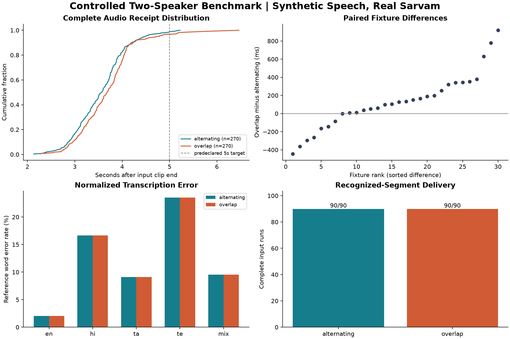

# Controlled Two-Speaker Speech Benchmark

Protocol date: 2026-10-12. Real-provider, synthetic-input, local-loopback experiment.

## Executive Results

- Completed trial checkpoints: 90/90; diagnostic trials excluded.
- Unique fixtures: 30; measured input runs: 180; stable-listener input-target checks: 540.
- Recognized segment-target checks: 540; valid delivered checks: 540.
- Failed trials: 0. No measured trial retries/replacements.

| Condition | Complete Inputs | Post-Clip Last-Audio p50 | p95 | Normalized WER | CER |
| --- | ---: | ---: | ---: | ---: | ---: |
| alternating | 90/90 | 3564.38 ms | 4487.82 ms | 11.65% | 8.01% |
| overlap | 90/90 | 3677.46 ms | 4789.84 ms | 11.65% | 8.01% |

These latency values are complete recognized-segment payload receipt, not playback or human translation quality.
Input-target checks and repeats are correlated; they are not independent sample sizes for statistical claims.

## Method and Reproducibility

See `../../../docs/CONTROLLED-BENCHMARK-PLAN.md` for the protocol fixed before live measurement.
Thirty cached PCM16/16kHz synthetic fixtures: six per source category; three repetitions, matched pairs, seeded randomized/counterbalanced condition order.
Alternating inputs have a one-second inter-clip gap; overlapping B starts 0.3 seconds after A. Both STT streams stay independent.
Three stable listen-only targets, with target-language rotation. Both speakers hear the first listener's language. One Docker worker; paced 100ms PCM frames.
Each trial awaits upstream end and ordered worker drain. Every final transcript sequence must have exactly one valid WAV and translation per stable target.
Delivery completeness is conditional on recognized segments. Reference WER/CER separately quantify transcription deviations; no semantic correctness assumption.
Base source commit: `fd4cbd624336810bdd84efd3cf1e25bc8952dd89`; tested working-tree backend SHA-256: `14000367fc63ac27f747dd9a6c4c278358bbbf30b4ad35695d3f3a7f02d0841d`. Completion instrumentation was added before this campaign; the hashes identify the actual tested source.
Harness SHA-256: `70687d9863206c56e62e583198e611528555d41e3734101147036b33dd6b9947`; Docker image: `sha256:9a948687fd12aaf460217051ff76595de4548cad8276ebeee43dc529b49de599`.
Host: Windows-11-10.0.26200-SP0; Python 3.12.10; transport: local loopback WebSocket.

Configured models: `saaras:v3-realtime` / auto language / codemix / fast stream; `mayura:v1` translation; `bulbul:v3` / kavitha / 16kHz WAV synthesis. VAD silence=500ms, threshold=0.3, minimum speech=250ms.

## Timing Definitions

- First-audio from input start includes speaking duration, VAD, API processing and local delivery.
- Post-clip last audio subtracts the end of nominal real-time clip transmission from arrival of the last segment payload.
- Post-signal last audio subtracts the last sample above absolute amplitude 400. This is a threshold-based synthetic boundary, not a human-labelled speech end.
- WAV validation/decode occurs after recording arrival. Server STT/queue/translate/TTS timings are recorded separately; their percentile sums are not end-to-end percentiles.
- p50/p95 use nearest rank: sorted index ceil(p*n)-1. Missing values are excluded and their denominators are explicit in the CSV.

## Boundary Sensitivity

| Condition | Input-Start First-Audio p50 / p95 (ms) | Post-Clip Last-Audio p50 / p95 | Post-Signal Last-Audio p50 / p95 |
| --- | ---: | ---: | ---: |
| alternating | 7303.58 / 8950.54 | 3564.38 / 4487.82 | 3823.19 / 4748.17 |
| overlap | 7324.55 / 9147.80 | 3677.46 / 4789.84 | 3968.56 / 4922.85 |

Clip end can include trailing silence; the signal threshold is an approximation, not native-labelled speech end. The predeclared five-second target uses clip end only.

## Source Breakdown

| Condition | Source | Inputs | Complete | Post-Clip p50 / p95 (ms) | WER / CER (%) |
| --- | --- | ---: | ---: | ---: | ---: |
| alternating | en | 18 | 18 | 3161.96 / 3752.01 | 2.04 / 2.56 |
| alternating | hi | 18 | 18 | 3788.85 / 4554.75 | 16.67 / 19.67 |
| alternating | ta | 18 | 18 | 3533.08 / 4615.23 | 9.09 / 0.71 |
| alternating | te | 18 | 18 | 3730.72 / 4551.23 | 23.53 / 17.33 |
| alternating | mix | 18 | 18 | 3509.13 / 4689.42 | 9.52 / 3.33 |
| overlap | en | 18 | 18 | 3390.70 / 4679.24 | 2.04 / 2.56 |
| overlap | hi | 18 | 18 | 3881.96 / 5846.28 | 16.67 / 19.67 |
| overlap | ta | 18 | 18 | 3601.98 / 4789.84 | 9.09 / 0.71 |
| overlap | te | 18 | 18 | 3860.55 / 4320.42 | 23.53 / 17.33 |
| overlap | mix | 18 | 18 | 3579.15 / 4078.85 | 9.52 / 3.33 |

Per-source/target-language results and denominators: `language_pairs.csv`.

## Server Stage Timings

STT timing includes speech duration (VAD speech-start to transcript commit), not isolated model inference time.
| Condition | STT p50 / p95 (ms) | Queue p50 / p95 | Translate p50 / p95 | TTS p50 / p95 |
| --- | ---: | ---: | ---: | ---: |
| alternating | 3735.00 / 4947.00 | 0.00 / 0.00 | 1813.00 / 2120.00 | 1156.00 / 1742.00 |
| overlap | 3797.00 / 5055.00 | 0.00 / 0.00 | 1825.00 / 2209.00 | 1180.00 / 1949.00 |

## Paired Comparison

Positive differences mean overlap was slower or had higher transcription error.
Average repeats/targets within fixture, then bootstrap fixture-level mean differences (2,000 resamples, seed 20261012).

| Metric | Paired Fixtures | Mean Difference | Fixture Bootstrap 95% | Pair-Block Bootstrap 95% |
| --- | ---: | ---: | ---: | ---: |
| mean_last_audio_after_clip_end_ms | 30 | 129.8996 | [26.8084, 240.5271] | [2.2812, 276.5868] |
| mean_last_audio_after_signal_end_ms | 30 | 129.8996 | [26.8084, 240.5271] | [2.2812, 276.5868] |
| wer | 30 | 0.0000 | [0.0000, 0.0000] | [0.0000, 0.0000] |
| cer | 30 | 0.0000 | [0.0000, 0.0000] | [0.0000, 0.0000] |

Latency differences are milliseconds; WER/CER differences are fractions. This interval reflects this small synthetic fixture sample, not all speakers/networks.
`paired.csv` additionally reports pair-block bootstrap intervals (15 paired-trial blocks), accounting for two fixtures sharing a trial; paired repeats with missing latency are excluded together.

## Predeclared Exploratory Targets

- alternating: >=95% complete input delivery: **met**; post-clip p95 <=5s: **met**.
  Descriptive Wilson interval: 95.91% to 100.00%; repetitions are dependent, so not a production SLA.
- overlap: >=95% complete input delivery: **met**; post-clip p95 <=5s: **met**.
  Descriptive Wilson interval: 95.91% to 100.00%; repetitions are dependent, so not a production SLA.

STT connection setup: n=180, p50=145.00 ms, p95=172.00 ms. Clip timing starts after all participants are ready; setup is not included in post-clip latency.

## Language-Group Fan-Out

Successful distinct-target pipeline invocations: **540**; recipient-level invocations without grouping: **720**.
Counterfactual call-count reduction for these observed recipients: **25.00%** for translation and TTS separately.
This is computed from actual successful pipeline recipient lists. It is not an A/B performance or billing comparison; failed calls may still incur cost.

## Failure and Integrity Observations

No measured trial failed the full-delivery criterion. This does not establish 100% production reliability or translation accuracy.
Duplicate audio messages: 0; invalid WAV messages: 0; missing recognized segment outputs: 0.
Provider end counts agreeing with collected transcript counts: 180/180. Complete fixture transmission checks: 180/180.
Maximum recorded next-frame deadline overrun: 0.00 ms.
The harness field named `max_frame_lateness_ms` measures overrun of the NEXT scheduled frame deadline after send, not absolute per-frame dispatch jitter. Zero does not prove zero jitter; no per-frame dispatch trace was recorded.

## Consumption

Measured PCM sent (including silence): 1129.00 seconds; unique fixture speech clips total 110.85 seconds before repetition.
Benchmark ledger (includes diagnostics and any resumed attempts): `{"stt_seconds": 11040.0, "translate_chars": 24042.0, "tts_chars": 25259.0}`.
Conservative reserved-cost estimate: INR 215.861 excluding GST, using project rate assumptions INR30/hour STT, INR20/10k translation chars, INR30/10k TTS chars.
STT reserves whole 60-second sessions; do not mistake this estimate for actual Sarvam charges. No billing dashboard balance was queried.
Provider-reported audio-duration records: 180/180 speaker sessions; sum 1129.00 seconds where available.

Measured-only processing estimate: INR 130.731 excluding GST, using 1129.00 provider-reported audio seconds, 23508 successful translation input characters, and 24769 observed TTS input characters. Diagnostic calls excluded; failed/retried internal HTTP calls could be additional.
Rates checked against [Sarvam pricing documentation](https://docs.sarvam.ai/api/getting-started/pricing). This is computed usage x listed prices, NOT an account billing receipt.

## Limitations and Claim Boundaries

- Synthetic voice reused across conditions; not diverse human voices, microphones, accents or acoustic echo/noise.
- Model-generated non-English references are not native-verified. Normalization/code-mix transliteration affects WER/CER. Character edits use Unicode codepoints, not graphemes.
- WER/CER compare STT output to the TTS input script, not a human-verified transcript of the generated waveform. Fixture pronunciation errors can contribute; do not attribute every mismatch to STT or claim isolated recognition accuracy.
- No native-speaker semantic or spoken-intelligibility review. Native-review CSV is explicitly unreviewed.
- Loopback excludes public tunnel, WAN variability and actual microphone capture/playback. Browser replay is separate, cached-TTS component validation.
- Shared development laptop, not a dedicated isolated load generator. Companion analysis/tests may add background work; seeded order reduces but does not eliminate time/host-load confounding.
- No 30-minute endurance, multi-room throughput, more-than-two-speaker stress or production SLA validation.
- One utterance per speaker session: low queue delay here is not a sustained-conversation backpressure test.
- Descriptive percentiles are specific to this sample. Historical developmental results are not merged or used to claim a latency improvement.

## Evidence Files

`manifest.json`, `metadata.json`, `trials/`, `events/`, `inputs.csv`, `targets.csv`, `segments.csv`, `trial_observations.csv`, `summary.csv`, `paired.csv`, `summary.json`, `native_review.csv`.
Cached WAV files and the isolated backend ledger/metrics are ignored local runtime files under `logs/controlled-benchmark/`.

## Transcription Review Examples

Highest normalized WER fixtures (unique IDs). Human review must distinguish recognition mistakes from acceptable representation changes.

### te_3 (te, WER 50.00%)

Reference: మీరు రేపటిలోగా నివేదిక పంపగలరా?

Observed: మీరు రేపటి యోగ నివేదిక పంపగలరా?

### ta_18 (ta, WER 33.33%)

Reference: அவளுடைய விளக்கக்காட்சி மிகவும் தெளிவாகவும் பயனுள்ளதாகவும் இருந்தது.

Observed: அவளுடைய விளக்கக் காட்சி மிகவும் தெளிவாகவும் பயனுள்ளதாகவும் இருந்தது

### te_4 (te, WER 33.33%)

Reference: నా తమ్ముడు కళాశాలలో కంప్యూటర్ సైన్స్ చదువుతున్నాడు.

Observed: నా తమ్ముడు కళాశాలలో Computer Science చదువుతున్నాడు.

### hi_18 (hi, WER 28.57%)

Reference: उसका प्रेजेंटेशन बहुत साफ और उपयोगी था।

Observed: उसका presentation बहुत साफ़ और उपयोगी था।

### mix_1 (mix, WER 28.57%)

Reference: அந்த meeting நாளைக்கு morning ku postpone ஆகிடுச்சு.

Observed: அந்த meeting நாளைக்கு morningக்கு postpone ஆகிடுச்சு

## Browser Playback Replay

Cached WAVs from pairs 1-3, repetition 1, both conditions were replayed at measured receipt offsets.
Browser: Edge/Chromium 154.0.4258.62. Actual frontend queue and media player; mocked delivery socket, no paid API calls.
Desktop 1440x1000 and mobile-sized 390x844 browser viewports; mobile viewport is not physical mobile hardware.
| Viewport | Condition | Clips Started / Expected | Receive-to-Playing p50 / p95 (ms) |
| --- | --- | ---: | ---: |
| 1440 | alternating | 6/6 | 76.40 / 162.20 |
| 1440 | overlap | 6/6 | 82.40 / 4293.80 |
| 390 | alternating | 6/6 | 71.40 / 109.50 |
| 390 | overlap | 6/6 | 347.90 / 4522.20 |
Replay cases: 12; cases with errors: 0; horizontal-overflow cases: 0.
Media endings: 24/24; media errors: 0. FIFO playback order checked.
Queueing can dominate playback delay when translated replies arrive together. Do not add these replay percentiles to live provider percentiles or claim live end-to-end timing.

## Validation

Independent raw-data validation: **passed**. See `verification.json` for counts and checked invariants.

## Interpretation and Next Work

1. Delivery held in this controlled sample: 180 input runs and 540 stable-listener checks. This is observed completeness, not a production reliability guarantee.
2. Mean paired overlap overhead was 129.90 ms; pair-block 95% bootstrap interval [2.28, 276.59] ms. Do not claim overlap had zero latency cost.
3. WER/CER were unchanged between conditions in this dataset, consistent with independent streams. This is not evidence of acoustic source separation or semantic accuracy.
4. Cached playback replay shows extra overlap queue delay. Real user-perceived latency can exceed audio-receipt latency; investigate queued TTS length/turn handling before making a sub-five-second end-to-end claim.
5. Native-review the generated audio/reference alignment and translations, particularly the larger Hindi/Telugu reference mismatches. Add diverse human-recorded speech in a separate follow-up dataset.
6. Any latency optimization needs a new controlled run on the same paired dataset with changed code clearly identified. Do not compare these post-clip numbers with old input-start numbers as a percentage improvement.

## Evidence-Backed Portfolio Wording

- Built a reproducible real-provider WebSocket benchmark covering 30 multilingual/code-mixed synthetic fixtures, alternating and overlapping two-speaker input, three repetitions and 540 complete listener results.
- Observed post-clip complete-audio-receipt p95 of 4.49s alternating and 4.79s overlapping in a local-loopback benchmark; playback excluded.
- Grouped translation/TTS by target language, using 540 successful pipelines for 720 recipient-level deliveries (25.00% fewer logical invocations than a per-recipient design in the measured trials).

Avoid: production-scale, 100% reliable, 88% translation accuracy, <5s live end-to-end, zero-overlap penalty, 30-minute endurance verified, or 25% measured total billing savings.

## Distribution Plots

